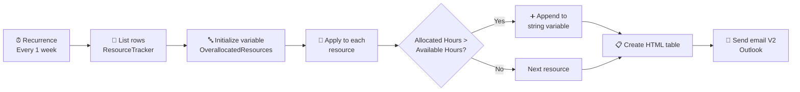

# 📊 Weekly BIM Resource Report Automation

### Scheduled Power Automate flow that turns a manual weekly report into a hands-free, error-free email

**⏱ 32 min saved per week &nbsp;•&nbsp; 📉 91% less manual effort &nbsp;•&nbsp; ⚡ 3 second run time**

---

## 🎯 The Problem

Every week, a BIM coordinator manually opens the resource tracker, checks hours, calculates utilisation, spots overallocated staff, builds a report and emails it. It is **repetitive, slow and easy to get wrong**.

## 💡 The Solution

A scheduled cloud flow in **Microsoft Power Automate** reads the Excel tracker every week, flags every resource whose allocated hours exceed available hours, builds an HTML report table and emails it to management automatically.

---

## 🔄 How It Works

<b>📋 View action-by-action breakdown</b>

| # | Action | Purpose |
|---|--------|---------|
| 1 | Recurrence | Starts the flow automatically every week |
| 2 | List rows present in a table (Excel Online) | Reads all rows of the `ResourceTracker` table |
| 3 | Initialize variable (`OverallocatedResources`, String) | Creates an empty text variable for alerts |
| 4 | Apply to each | Loops through each of the 5 resources |
| 5 | Condition | Checks if Allocated Hours > Available Hours |
| 6 | Append to string variable (True branch) | Adds Resource ID, Discipline and hours to the alert text |
| 7 | Create HTML table | Formats resource data into a readable table |
| 8 | Send an email (V2) – Office 365 Outlook | Emails the report |

The False branch has no actions, so the flow simply moves to the next resource.

---

## 📂 Sample Dataset

`Sample_BIM_Resource_Tracker.xlsx` is stored in OneDrive for Business and formatted as an Excel table named **`ResourceTracker`**.

| Resource ID | Discipline | Available Hrs | Allocated Hrs | Utilisation | Status |
|:-----------:|:----------:|:-------------:|:-------------:|:-----------:|:------:|
| BIM-201 | Architecture | 40 | 52 | 130% | 🔴 Overallocated |
| BIM-202 | Architecture | 40 | 36 | 90% | 🟢 Normal |
| STR-101 | Structure | 40 | 32 | 80% | 🟢 Normal |
| MEP-105 | MEP | 40 | 44 | 110% | 🔴 Overallocated |
| ARC-110 | Architecture | 40 | 28 | 70% | 🟢 Normal |

> **Formula:** `Utilisation % = Allocated Hours / Available Hours` (`=D2/C2`).
> A resource is **Overallocated** when utilisation is above 100%.

---

## 📸 Screenshots

**Complete working flow, all steps successful**

**Append to string variable**

**Successful test run**

**Automated weekly report email**

---

## ✅ Test Results

| Metric | Result |
|--------|--------|
| Resources checked | **5** |
| Overallocated | **2** (BIM-201, MEP-105) |
| Run duration | **3 seconds** |
| Status | **Test succeeded** ✅ |

---

## ⏱ Time Savings (Estimated)

| | Before | After |
|---|:---:|:---:|
| Collect data, check, calculate, format, send | 35 min | – |
| Review report + verify results | – | 3 min |
| **Per week** | **35 min** | **3 min** |

### 🏆 ~32 minutes saved per week &nbsp;|&nbsp; ~128 minutes per month &nbsp;|&nbsp; ~91% reduction

*Estimates based on typical manual effort, not measured results. They assume the same reporting scope and successful automated runs.*

---

## 🧹 Manual Steps Eliminated

| Before | After |
|--------|-------|
| Opening the Excel tracker | ✅ Automated data retrieval |
| Checking every resource | ✅ Automated row processing |
| Identifying overallocated resources | ✅ Automated condition |
| Preparing the report table | ✅ Automated HTML table |
| Drafting the weekly email | ✅ Automated email generation |
| Sending the report | ✅ Automated email delivery |

> 🧠 **Human review is still part of the process.** The automation handles preparation, while management decides on workload redistribution.

---

## 🚀 Future Enhancements

- [ ] Power BI dashboard for utilisation trends
- [ ] Add Utilisation % and Status columns to the email table
- [ ] Teams alert for critical overallocation (above 120%)
- [ ] Multi-project and multi-week tracking

---

## 📄 Documentation

Full assignment report: [`Weekly_BIM_Report_Automation_Assignment.pdf`](Weekly_BIM_Report_Automation_Assignment.pdf)

## 🔗 Related Project

[Automated Approval Workflow using Power Automate, Excel & Outlook](https://github.com/automationanalysis/didactic-journey-power-automate-approval-workflow)

---

### 👩‍💼 Aakanksha Chaudhary

*Automating repetitive work so people can focus on decisions.*

⭐ If you found this useful, consider starring the repo.

